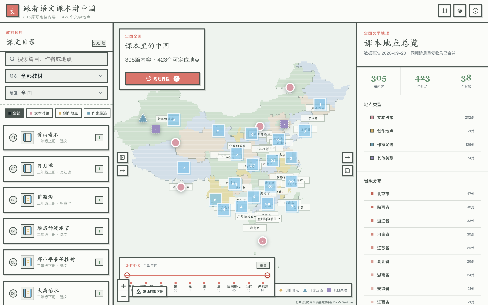
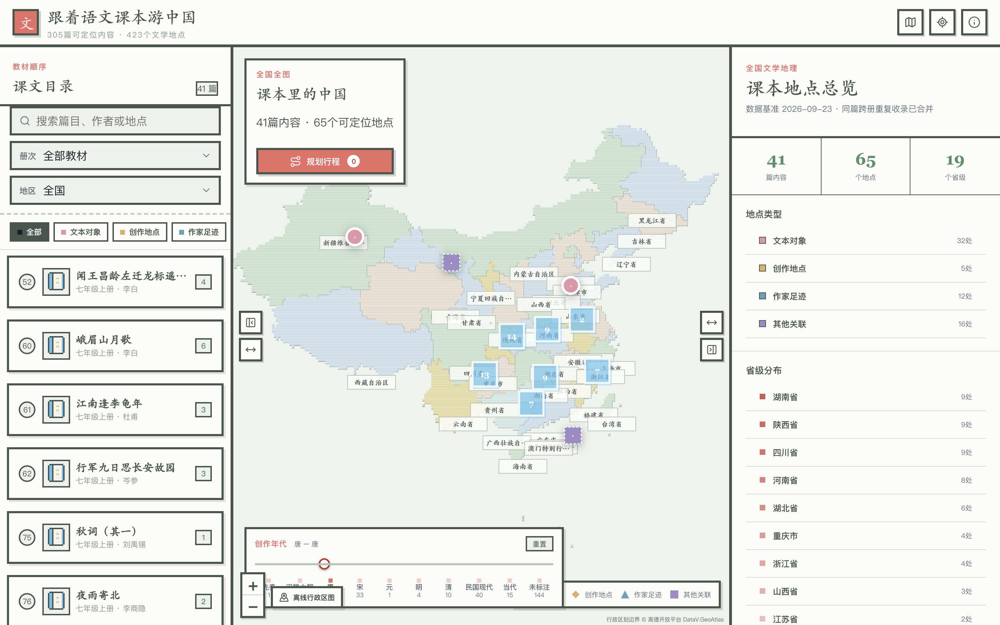
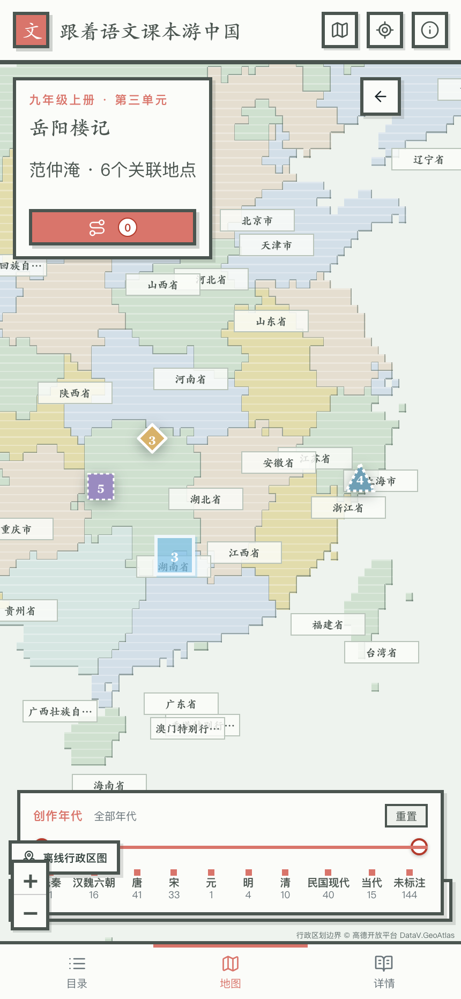

# 跟着语文课本游中国

一个把小学、初中、高中语文教材中的课文、作者与真实地理空间连接起来的互动文学地图。

## 在线体验

**[点击打开作品](https://lyna-textbook-travel-china.netlify.app/)**

> 本仓库仅用于作品展示，不包含项目源代码、完整数据文件或离线资源包。

## 作品概览

- 收录 305 篇教材内容，覆盖小学、初中、高中三个学段
- 整理 423 个文学关联地点，并按文本对象、创作地点、作家足迹和其他关联分类
- 支持省市级联、教材册次、课文类型、创作年代等多维筛选
- 支持离线行程规划，并可跳转高德地图或百度地图
- 提供桌面端与移动端适配

## 界面展示

### 全国文学地图

### 创作年代筛选

### 移动端课文详情

## 数据说明

作品依据语文教材基础信息、教材正文及公开地理资料整理。历史地点按照现行行政区划进行映射，地图边界数据来自高德开放平台 DataV.GeoAtlas，街道路网数据来自 OpenStreetMap。

## 版权说明

本仓库中的文字介绍与界面截图仅用于本作品展示。除法律法规允许的情形外，未经授权不得复制、再发布、修改或用于商业用途。

Copyright (c) 2026. All rights reserved.
